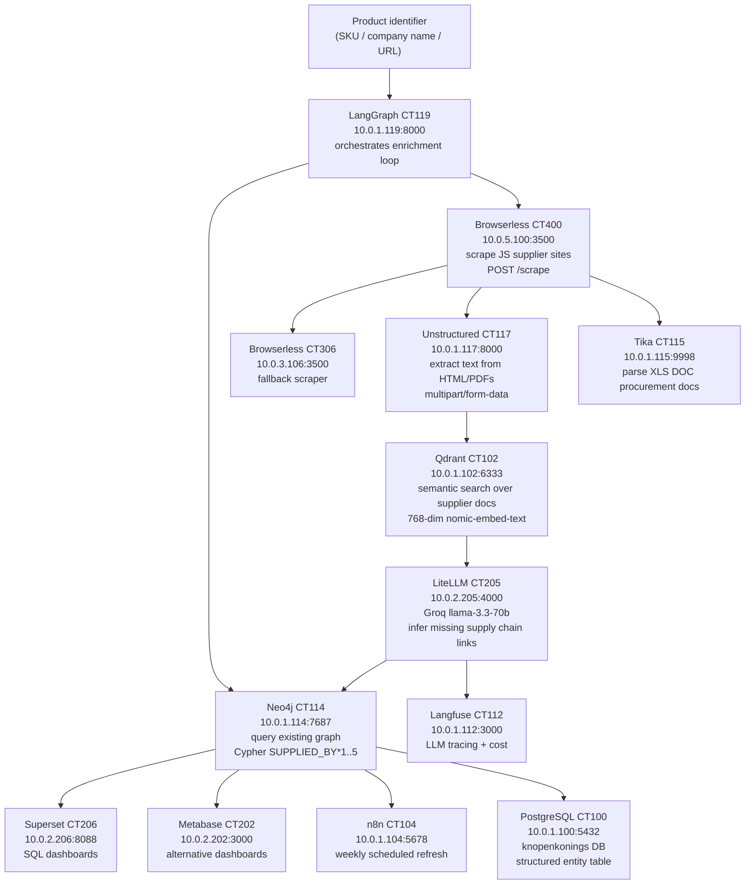

# UC4 — Supply Chain Visualization (Knopenkoning / Scania)

Given a product SKU or company name, this pipeline traverses the full supply chain
backwards: who supplies this component, who supplies the supplier, where do raw materials
originate. AI agents infer missing links. Everything is stored as a directed graph in
Neo4j. Superset and Metabase provide dashboards for supply chain analysts.

**Primary demo:** Scania AB (heavy trucks) — tier 1/2/3 supplier mapping.
**Secondary demo:** Knopenkoning (buttons) — AMS Buttons BV → Shenzhen Metal Co → raw materials.

---

## Pipeline Flow



---

## Quick Start (Dry Run)

```bash
# 1. VPN required
bash scripts/vpn-connect.sh connect

# 2. Run all 8 dry-run steps
bash usecases/uc4-supply-chain/scripts/dry_run.sh

# 3. Health check only
bash usecases/uc4-supply-chain/scripts/health_check.sh
```

---

## Services

| Service | Container | IP:Port | Role |
|---------|-----------|---------|------|
| Neo4j | CT114 | 10.0.1.114:7474 (HTTP) / :7687 (Bolt) | Supply chain graph |
| LangGraph | CT119 | 10.0.1.119:8000 | Agent orchestration |
| Browserless (prod) | CT400 | 10.0.5.100:3500 | JS scraping |
| Browserless (acc) | CT306 | 10.0.3.106:3500 | Fallback scraper |
| Unstructured | CT117 | 10.0.1.117:8000 | HTML/PDF extraction |
| Tika | CT115 | 10.0.1.115:9998 | Binary doc parsing |
| Qdrant | CT102 | 10.0.1.102:6333 | Vector search |
| LiteLLM | CT205 | 10.0.2.205:4000 | LLM inference |
| Superset | CT206 | 10.0.2.206:8088 | SQL dashboards |
| Metabase | CT202 | 10.0.2.202:3000 | Alternative dashboards |
| n8n | CT104 | 10.0.1.104:5678 | Scheduled refresh |
| PostgreSQL | CT100 | 10.0.1.100:5432 | Structured entity table |
| Langfuse | CT112 | 10.0.1.112:3000 | LLM tracing |

---

## Credentials

Stored in `passwords.kdbx` (master: `SupplyChainBaby100!`).

```python
from pykeepass import PyKeePass
kp = PyKeePass('usecases/uc4-supply-chain/passwords.kdbx', password='SupplyChainBaby100!')
neo4j = kp.find_entries(title='Neo4j', first=True)
print(neo4j.password)
```

---

## Neo4j Graph Schema

```cypher
// Node types
(p:Product {name, sku, category})
(s:Supplier {name, country, website, tier})
(r:RawMaterial {name, origin, material_type})
(c:Company {name, country, industry})
(cert:Certificate {name, issuer, valid_until})

// Relationships
(p)-[:SUPPLIED_BY {since, contract_value}]->(s)
(s)-[:SOURCED_FROM {volume_kg_year}]->(r)
(s)-[:CERTIFIED_BY]->(cert)
(s)-[:OWNED_BY]->(c)
(c)-[:SUBSIDIARY_OF]->(c)
```

---

## Critical Notes

- Browserless: endpoint is `/scrape` (NOT `/chromium/content`), port 3500
- CT400 has no SSH keys — use `pct exec 400 --` on node-4 (root@10.0.0.18)
- Unstructured requires `multipart/form-data` with `files` field — plain `text/html` body returns 422
- Embedding model: `ollama/nomic-embed-text` (768 dims) — NOT `text-embedding-3-small`
- Superset login issues: `systemctl restart superset` fixes PendingRollbackError
- Neo4j password: KeePass UC4 `Neo4j` entry, or CT114 `/root/.credentials/neo4j.txt`

See `CLAUDE.md` for full dry-run procedures and common failure fixes.
