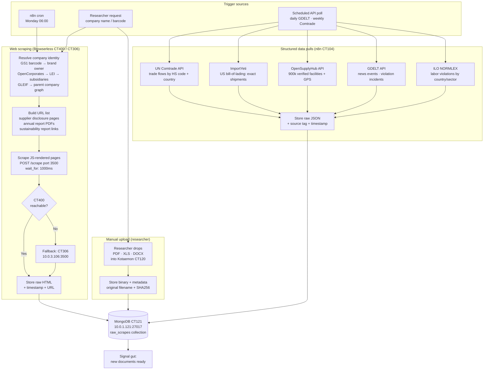
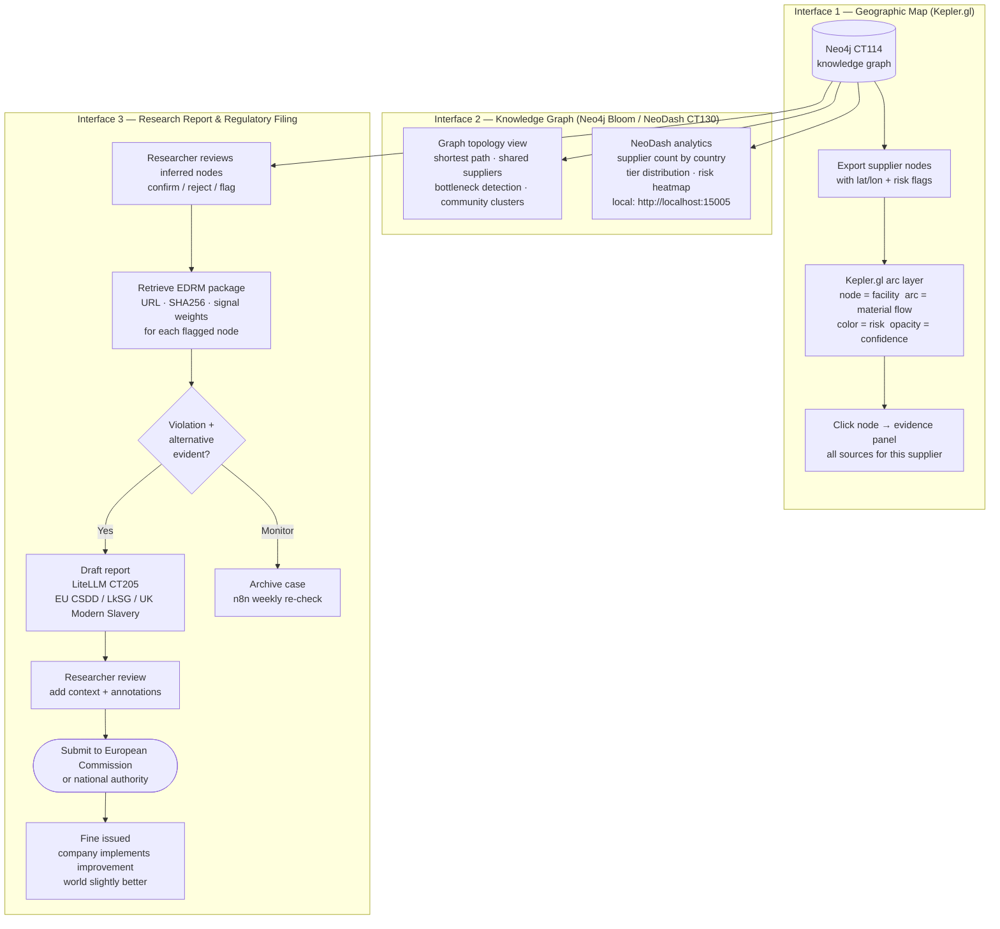
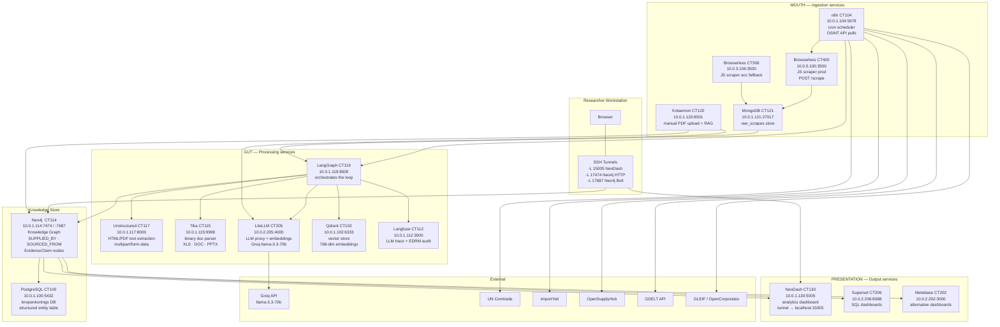

# SupplyLens — AI Supply Chain Intelligence & Regulatory Enforcement

Given a company name, product SKU, or barcode, SupplyLens automatically maps the
complete supply chain using OSINT, infers hidden Tier 3–5 nodes with AI confidence
scoring, flags violations, and produces EDRM-compliant evidence for EU regulatory
enforcement.

**Industry partner:** Scania AB (ground truth validation)
**Research goal:** Multi-signal OSINT inference + EDRM evidence chain + EU regulatory output
**Status:** All 8 dry-run steps PASS. Phases 1–10 built. NeoDash deployed (CT130).

> Full research concept, methodology, and academic context: see [VISION.md](VISION.md)

---

## Three Research Use Cases

| Use Case | Description | Output |
|----------|-------------|--------|
| **Supply Chain Mapping** | Auto-discover Tier 1–5 suppliers from OSINT | Probabilistic graph with confidence scores |
| **Material Alternative Research** | Find cheaper/greener alternatives to flagged materials | Cost + CO2 improvement proposal |
| **Suppressed Evidence & Regulatory Filing** | Prove a company knew about a better alternative and chose not to use it | EDRM-compliant EU enforcement report |

---

## System Architecture — Three Organs

SupplyLens is structured as three semi-independent organs. Each runs on its own
schedule and communicates through well-defined interfaces. The mouth ingests
continuously. The gut processes whenever raw data arrives. The presentation layer
reads Neo4j on demand — independently of when either of the others last ran.

```mermaid
flowchart LR
    EXT["External world\nwebsites · APIs · PDFs\nmanual uploads"]

    subgraph MOUTH ["MOUTH — Ingestion"]
        direction TB
        M1["Scrapers\nBrowserless CT400/306"]
        M2["Scheduled API pulls\nn8n CT104"]
        M3["Manual uploads\nresearcher drops PDFs"]
    end

    RAW[("Raw store\nMongoDB CT121\nHTML · PDFs · JSON")]

    subgraph GUT ["GUT — Processing & Inference"]
        direction TB
        G1["Extract\nUnstructured CT117\nTika CT115"]
        G2["Embed + index\nQdrant CT102\nnomic-embed-text 768-dim"]
        G3["Infer\nLangGraph CT119\nLiteLLM CT205 → Groq"]
        G4["Score + stamp\nconfidence fusion\nEDRM evidence record"]
    end

    KG[("Knowledge graph\nNeo4j CT114\nnodes · edges\nconfidence · evidence")]

    subgraph PRESENTATION ["PRESENTATION — Output"]
        direction TB
        P1["Map\nKepler.gl geographic arcs"]
        P2["Graph\nNeo4j Bloom · NeoDash CT130"]
        P3["Report\nEDRM PDF → EU authority"]
    end

    EXT --> MOUTH
    MOUTH --> RAW
    RAW --> GUT
    GUT --> KG
    KG --> PRESENTATION
```



---

### Organ 1 — The Mouth (Ingestion)

Runs on its own schedule. Output: raw documents in MongoDB CT121.
The gut is not involved. The mouth does not parse or infer — it only collects.



---

### Organ 2 — The Gut (Processing & Inference)

Triggered by new documents in MongoDB. Extracts, infers, scores, evidence-stamps.
Output: structured nodes + edges in Neo4j CT114.
Loops until depth limit or no new nodes found.

```mermaid
flowchart TD
    IN[("MongoDB CT121\nnew raw documents")] --> LANGGRAPH

    subgraph LANGGRAPH ["LangGraph CT119 — orchestrates the loop"]

        subgraph EXTRACT ["Step 1 — Extract"]
            E1["HTML/PDF → Unstructured CT117\nmultipart/form-data  POST /general/v0/general\nreturns structured text elements"]
            E2["Binary docs → Tika CT115\nXLS · DOC · PPTX  PUT /tika\nreturns plain text"]
        end

        subgraph EMBED ["Step 2 — Embed & Index"]
            EM1["Chunk text\n512-token windows"]
            EM2["Generate embeddings\nLiteLLM CT205 → nomic-embed-text\n768 dimensions"]
            EM3["Upsert into Qdrant CT102\ncollection: supplier_docs\nfor semantic search"]
        end

        subgraph INFER ["Step 3 — Infer Relationships"]
            I1["LiteLLM CT205 → Groq llama-3.3-70b\nprompt: extract supplier relationships\nfrom text as JSON array"]
            I2["Semantic search Qdrant\n'who supplies X?' → retrieve similar docs\ncross-validate inferred entities"]
        end

        subgraph SCORE ["Step 4 — Confidence Score Fusion"]
            S1["Trade signal  ×0.30\nComtrade + bill-of-lading match"]
            S2["Facility signal  ×0.25\nOpenSupplyHub GPS hit"]
            S3["Corporate signal  ×0.20\nOpenCorporates / GLEIF match"]
            S4["Document signal  ×0.15\nfound in annual report / filing"]
            S5["News signal  ×0.10\nGDELT event corroborates"]
            S1 & S2 & S3 & S4 & S5 --> FUSE["Weighted sum\n+ uncertainty band"]
        end

        subgraph EDRM ["Step 5 — EDRM Evidence Stamp"]
            EV1["Create EvidenceClaim node\nURL · SHA256 · timestamp\ninference method version"]
            EV2["Link: EvidenceClaim\n-[:EVIDENCE_FOR]->\nSupplier / RawMaterial node"]
            EV3["Log to Langfuse CT112\nfull LLM trace for audit"]
        end

        subgraph WRITE ["Step 6 — Write to Graph"]
            W1["MERGE Supplier / RawMaterial nodes\nMERGE SUPPLIED_BY / SOURCED_FROM edges\nset confidence · inferred: true"]
            W2["Apply risk flags\nSINGLE_SOURCE\nGEOPOLITICAL_RISK\nCBAM · LkSG · EUDR"]
            W3{New nodes\nfound and\ndepth < limit?}
            W3 -->|Yes — go deeper| EXTRACT
            W3 -->|Done| OUT
        end

    end

    EXTRACT --> EMBED --> INFER --> SCORE --> EDRM --> WRITE
    OUT[("Neo4j CT114\nnodes + edges\nconfidence + evidence")]
```



---

### Organ 3 — The Presentation Layer

Reads Neo4j on demand. Three independent interfaces for three use cases.
Regulatory report path is the end-to-end research output.



---

## Infrastructure Map

Services grouped by organ. All on internal Proxmox subnets — VPN required from workstation.



---

## Quick Start

```bash
# 1. VPN required
bash scripts/vpn-connect.sh connect

# 2. SSH tunnels (Neo4j + NeoDash)
ssh -f -L 15005:10.0.1.130:5005 -L 17474:localhost:7474 -L 17687:localhost:7687 \
    -N -o ProxyJump=root@10.0.0.16 root@10.0.1.114

# 3. Run all 8 dry-run steps
bash usecases/uc4-supply-chain/scripts/dry_run.sh

# 4. Health check
bash usecases/uc4-supply-chain/scripts/health_check.sh

# 5. Open NeoDash  (requires tunnel above)
#    → http://localhost:15005
#    → bolt://localhost:17687  |  neo4j  |  <password from KeePass>
```

---

## Services

| Service | Container | IP:Port | Role |
|---------|-----------|---------|------|
| Neo4j | CT114 | 10.0.1.114:7474 (HTTP) / :7687 (Bolt) | Supply chain knowledge graph |
| LangGraph | CT119 | 10.0.1.119:8000 | Agent orchestration |
| Browserless (prod) | CT400 | 10.0.5.100:3500 | JS scraping — `POST /scrape` |
| Browserless (acc) | CT306 | 10.0.3.106:3500 | Fallback scraper |
| Unstructured | CT117 | 10.0.1.117:8000 | HTML/PDF text extraction |
| Tika | CT115 | 10.0.1.115:9998 | Binary doc parsing (XLS, DOC) |
| Qdrant | CT102 | 10.0.1.102:6333 | Vector search (768-dim) |
| LiteLLM | CT205 | 10.0.2.205:4000 | LLM proxy + embeddings |
| Kotaemon | CT120 | 10.0.1.120:8501 | RAG over supplier docs |
| NeoDash | CT130 | 10.0.1.130:5005 | Analytics dashboard |
| Superset | CT206 | 10.0.2.206:8088 | SQL dashboards |
| Metabase | CT202 | 10.0.2.202:3000 | Alternative dashboards |
| n8n | CT104 | 10.0.1.104:5678 | Scheduled OSINT refresh |
| PostgreSQL | CT100 | 10.0.1.100:5432 | Structured entity table |
| Langfuse | CT112 | 10.0.1.112:3000 | LLM tracing + evidence chain |

---

## Credentials

Stored in `passwords.kdbx` (master: `SupplyChainBaby100!`).

```python
from pykeepass import PyKeePass
kp = PyKeePass('passwords.kdbx', password='SupplyChainBaby100!')
neo4j = kp.find_entries(title='Neo4j', first=True)
print(neo4j.password)
```

Or read directly: `ssh root@10.0.1.114 "cat /root/.credentials/neo4j.txt"`

---

## Neo4j Graph Schema

```cypher
// Node types
(p:Product   {name, sku, category})
(s:Supplier  {name, country, website, tier, risk_flags[]})
(r:RawMaterial {name, origin, material_type})
(c:Company   {name, country, industry})
(cert:Certificate {name, issuer, valid_until})
(ev:EvidenceClaim {source_url, sha256, timestamp, confidence, signals[]})

// Relationships
(p)-[:SUPPLIED_BY  {since, contract_value}]->(s)
(s)-[:SOURCED_FROM {volume_kg_year, confidence, inferred}]->(r|s)
(s)-[:CERTIFIED_BY]->(cert)
(s)-[:OWNED_BY]->(c)
(c)-[:SUBSIDIARY_OF]->(c)
(ev)-[:EVIDENCE_FOR]->(s|r)

// Traversal pattern
MATCH path = (p:Product {sku: $sku})-[:SUPPLIED_BY|SOURCED_FROM*1..3]->(n)
RETURN [node in nodes(path) | coalesce(node.name, node.sku)] AS chain,
       length(path) AS depth
ORDER BY depth
```

---

## Confidence Score Model

Every inferred node carries a weighted confidence score from 5 OSINT signals:

| Signal | Weight | Source |
|--------|--------|--------|
| Trade flow data | 0.30 | UN Comtrade, ImportYeti bill-of-lading |
| Facility location | 0.25 | OpenSupplyHub, satellite imagery |
| Corporate structure | 0.20 | OpenCorporates, GLEIF LEI |
| Document extraction | 0.15 | Annual reports, sustainability filings |
| News & incidents | 0.10 | GDELT, NGO databases, ILO |

---

## Critical Notes

- Browserless endpoint: `POST /scrape` port 3500 — NOT `/chromium/content`
- CT400 has no SSH — use `pct exec 400 --` on node-4 (`root@10.0.0.18` via `~/.ssh/proxmox_node3`)
- Unstructured requires `multipart/form-data` with `files` field — plain `text/html` body = HTTP 422
- Embedding model: `ollama/nomic-embed-text` (768 dims) — NOT `text-embedding-3-small`
- Superset login fails: `systemctl restart superset` fixes PendingRollbackError
- Groq key corruption: check `/etc/litellm/config.yaml` line ~230 for box-drawing chars (`\xe2\x94\x80`)
- Node-1 bastion: `-o ProxyJump=root@10.0.0.16` | Node-2 bastion: `-o ProxyJump=root@10.0.0.15`

See `CLAUDE.md` for full dry-run procedures and failure fix table.
See `VISION.md` for research methodology and academic context.
