# UC4 SupplyLens (Supply Chain) — workflow

<!-- Generated from docs/workflow.yml by ResearchReady/workbook/scripts/workflows.py --write-repos. Edit the YAML, not this file. -->

SupplyLens maps a company's supply chain into Neo4j and analyses it. Every service passed the dry-run and the analysis modules and dashboards are built. The LangGraph agent that automates scrape → extract → infer → merge exists as code but is not deployed, the Scania graph is not seeded (cluster unreachable over VPN), and Kotaemon evidence RAG is not provisioned.

**18 steps:** 10 working, 5 partial / unverified, 1 broken / blocked, 2 planned, not built. Updated 2026-09-28.

✅ **Working** · ⚠️ **Partial / unverified** · ❌ **Broken / blocked** · ⏳ **Planned, not built** · solid arrow = automated · dashed arrow = not wired yet

```mermaid
flowchart LR
    subgraph lane_input["Input"]
        n_company(["✅ Company / product"])
        n_refresh["⚠️ Weekly refresh (Mon 06:00)<br/><small>n8n CT104</small>"]
        n_agent["⚠️ SupplyLens agent<br/><small>LangGraph CT119</small>"]
    end
    subgraph lane_collect["Collect & extract"]
        n_scrape["✅ Scrape supplier pages<br/><small>Browserless CT400</small>"]
        n_extract["✅ Extract text<br/><small>Unstructured CT117 / Tika CT115</small>"]
        n_rag["⏳ Evidence RAG + citations<br/><small>Kotaemon CT120</small>"]
    end
    subgraph lane_infer["Infer & store"]
        n_embed[("✅ Embed<br/><small>Qdrant CT102 (nomic-embed)</small>")]
        n_llm["✅ Infer hidden suppliers<br/><small>LiteLLM CT205</small>"]
        n_graph[("✅ Supply-chain graph<br/><small>Neo4j CT114</small>")]
        n_seed["❌ Seed Scania demo graph<br/><small>scripts/seed_scania.sh</small>"]
        n_evidence[("✅ Evidence store (EDRM)<br/><small>src/evidence_store.py</small>")]
        n_pg[("⚠️ Supplier table sync<br/><small>PostgreSQL knopenkonings</small>")]
    end
    subgraph lane_analyse["Analyse"]
        n_modules["✅ Risk, CBAM, resilience, Monte Carlo, sanctions, carbon, dual sourcing<br/><small>src/*.py</small>"]
    end
    subgraph lane_present["Present"]
        n_html(["✅ Interactive dashboards<br/><small>docs/*.html</small>"])
        n_live3d["⚠️ 3D graph with live evidence"]
        n_bi["⚠️ BI dashboards<br/><small>Superset CT206 / Metabase CT202</small>"]
        n_pdf["⏳ Supplier scorecard PDF"]
        n_book(["✅ SupplyLens book<br/><small>Gitea Actions</small>"])
    end
    n_company -.-> n_agent
    n_refresh -. weekly .-> n_agent
    n_agent --> n_scrape
    n_scrape --> n_extract
    n_extract -.-> n_rag
    n_extract --> n_embed
    n_embed --> n_llm
    n_llm -- MERGE --> n_graph
    n_seed -.-> n_graph
    n_graph --> n_evidence
    n_graph -.-> n_pg
    n_graph -. export .-> n_modules
    n_modules --> n_html
    n_evidence -.-> n_live3d
    n_pg -.-> n_bi
    n_modules -.-> n_pdf
    style lane_input fill:#f7f9fb,stroke:#b0bec5,color:#263238,stroke-width:1px
    style lane_collect fill:#f7f9fb,stroke:#b0bec5,color:#263238,stroke-width:1px
    style lane_infer fill:#f7f9fb,stroke:#b0bec5,color:#263238,stroke-width:1px
    style lane_analyse fill:#f7f9fb,stroke:#b0bec5,color:#263238,stroke-width:1px
    style lane_present fill:#f7f9fb,stroke:#b0bec5,color:#263238,stroke-width:1px
    linkStyle default stroke:#546e7a,stroke-width:2px
    classDef working fill:#2e7d32,stroke:#1b5e20,color:#ffffff,stroke-width:2px
    classDef partial fill:#f9a825,stroke:#b07800,color:#1a1a1a,stroke-width:2px
    classDef broken fill:#c62828,stroke:#7f1010,color:#ffffff,stroke-width:2px
    classDef planned fill:#eceff1,stroke:#90a4ae,color:#37474f,stroke-width:2px,stroke-dasharray:5 3
    class n_company,n_scrape,n_extract,n_embed,n_llm,n_graph,n_evidence,n_modules,n_html,n_book working
    class n_refresh,n_agent,n_pg,n_live3d,n_bi partial
    class n_seed broken
    class n_rag,n_pdf planned
```

## Steps

| Step | Service | Status | Source | Note |
|---|---|---|---|---|
| Company / product |  | ✅ Working | manual |  |
| Weekly refresh (Mon 06:00) | n8n CT104 | ⚠️ Partial / unverified | manual | 14-node workflow in config/n8n_workflow.json; not deployed |
| SupplyLens agent | LangGraph CT119 | ⚠️ Partial / unverified | manual | src/agent.py built; POST /runs not deployed on CT119 |
| Scrape supplier pages | Browserless CT400 | ✅ Working | manual |  |
| Extract text | Unstructured CT117 / Tika CT115 | ✅ Working | manual |  |
| Evidence RAG + citations | Kotaemon CT120 | ⏳ Planned, not built | manual | CT120 not provisioned (needs VPN) — PLAN B1/E5 |
| Embed | Qdrant CT102 (nomic-embed) | ✅ Working | manual |  |
| Infer hidden suppliers | LiteLLM CT205 | ✅ Working | manual | Groq llama-3.3-70b; inferred links carry a confidence |
| Supply-chain graph | Neo4j CT114 | ✅ Working | manual |  |
| Seed Scania demo graph | scripts/seed_scania.sh | ❌ Broken / blocked | manual | Blocked: bastion and CT114 unreachable over VPN (2026-08-24) |
| Evidence store (EDRM) | src/evidence_store.py | ✅ Working | manual |  |
| Supplier table sync | PostgreSQL knopenkonings | ⚠️ Partial / unverified | manual | src/postgres_sync.py exists; not scheduled |
| Risk, CBAM, resilience, Monte Carlo, sanctions, carbon, dual sourcing | src/*.py | ✅ Working | manual | Built; run standalone |
| Interactive dashboards | docs/*.html | ✅ Working | manual |  |
| 3D graph with live evidence |  | ⚠️ Partial / unverified | manual | Evidence still hard-coded (PLAN E3) |
| BI dashboards | Superset CT206 / Metabase CT202 | ⚠️ Partial / unverified | manual | Services up; dashboards not provisioned |
| Supplier scorecard PDF |  | ⏳ Planned, not built | manual | PLAN E4 |
| SupplyLens book | Gitea Actions | ✅ Working | manual |  |
